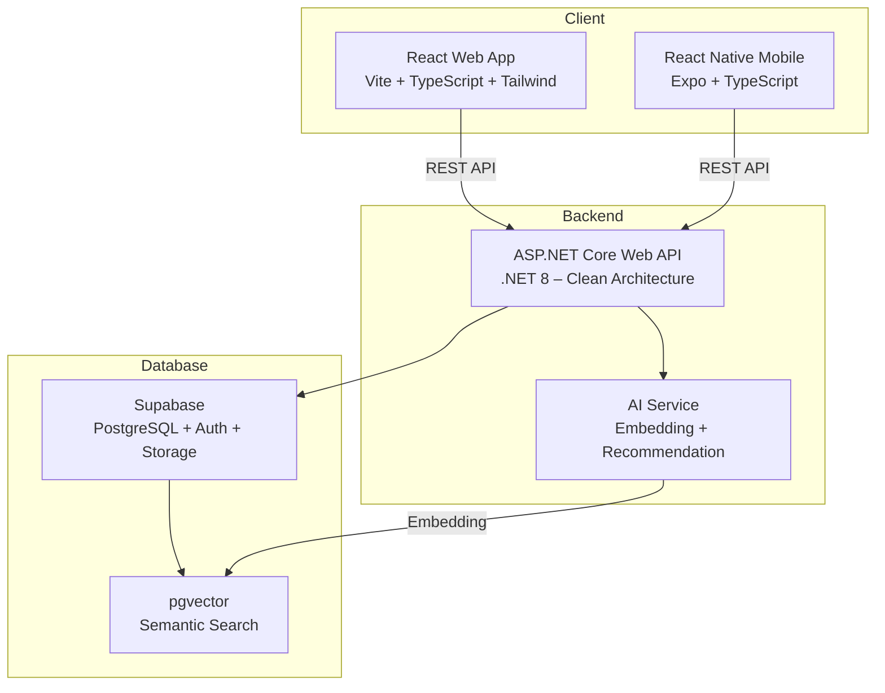

# 📚 SmartLibrary – Hệ thống quản lý thư viện thông minh

> Đồ án tốt nghiệp – Hệ thống quản lý thư viện tích hợp AI gợi ý sách theo nhu cầu người đọc.

## 🏗️ Kiến trúc hệ thống



## 📁 Cấu trúc Monorepo

```
SmartLibrary-FPT/
├── apps/
│   ├── web/        → React + Vite + TypeScript + TailwindCSS
│   ├── mobile/     → React Native (Expo) + TypeScript
│   └── api/        → .NET 8 ASP.NET Core Web API (Clean Architecture)
├── supabase/       → Migrations, seed data, config
├── docs/           → Tài liệu kiến trúc, API, sơ đồ
├── deploy/         → Docker, Nginx, scripts
└── .github/        → CI/CD workflows, templates
```

## 🚀 Cách chạy local

### Yêu cầu

| Tool | Version |
|---|---|
| Node.js | >= 20.x |
| .NET SDK | 8.0 |
| Docker | >= 24.x |
| Supabase CLI | >= 1.x |

### 1. Backend API

```bash
# Chạy từ thư mục gốc repository
npm run dev:api
# API chạy tại: http://localhost:5278
# Swagger: http://localhost:5278/swagger
# Health check: http://localhost:5278/api/health-check
```

`npm run dev:api` kiểm tra health check trước khi khởi động. Nếu API đang chạy khỏe trên cổng `5278`, lệnh sẽ bám vào tiến trình hiện có; nhấn **Ctrl+C** trong terminal đó để dừng đúng API của repository. Có thể dừng API tường minh bằng `npm run dev:api:stop`. Nếu cổng đang bị dịch vụ khác chiếm, lệnh sẽ báo rõ để bạn xử lý xung đột.

### 2. Web App

```bash
cd apps/web
npm install
cp .env.example .env.local
# Sửa biến môi trường trong .env.local
npm run dev
# Web chạy tại: http://localhost:5173
```

### 3. Mobile App

```bash
cd apps/mobile
npm install
cp .env.example .env.local
npx expo start
# Scan QR code bằng Expo Go
```

### 4. Supabase (Local)

```bash
supabase start
supabase db reset   # Apply migrations + seed data
```

## 🔑 Biến môi trường

| Biến | Mô tả | Dùng ở |
|---|---|---|
| `VITE_API_URL` | URL backend API | Web |
| `VITE_SUPABASE_URL` | Supabase project URL | Web |
| `VITE_SUPABASE_ANON_KEY` | Supabase anon key | Web |
| `EXPO_PUBLIC_API_URL` | URL backend API | Mobile |
| `EXPO_PUBLIC_SUPABASE_URL` | Supabase project URL | Mobile |
| `EXPO_PUBLIC_SUPABASE_ANON_KEY` | Supabase anon key | Mobile |
| `ConnectionStrings__DefaultConnection` | PostgreSQL connection string | API |
| `Jwt__Secret` | JWT signing secret (Supabase) | API |
| `Supabase__Url` | Supabase URL | API |
| `Supabase__AnonKey` | Supabase anon key | API |
| `Supabase__ServiceRoleKey` | Supabase service role key | API |
| `Resend__ApiKey` | Resend email API key | API |
| `Smtp__Username`, `Smtp__Password` | SMTP account credentials | API |
| `Smtp__FromAddress` | Sender email address | API |
| `Cloudinary__CloudName`, `Cloudinary__ApiKey`, `Cloudinary__ApiSecret` | Cloudinary credentials | API |

> ⚠️ **Không commit file `.env`!** Chỉ commit `.env.example`.
> Backend đọc biến môi trường hoặc .NET User Secrets trong môi trường Development. Ví dụ:
> `dotnet user-secrets set "ConnectionStrings:DefaultConnection" "<connection-string>" --project apps/api/src/SmartLibrary.Api`
> và cấu hình các key còn lại theo cùng cách, ví dụ `dotnet user-secrets set "Supabase:ServiceRoleKey" "<key>" --project apps/api/src/SmartLibrary.Api`.
> Các tài khoản/khóa từng xuất hiện trong file cấu hình hoặc ảnh chụp cần được đổi/thu hồi tại nhà cung cấp; xóa khỏi file hiện tại không thu hồi các khóa đó hay xóa chúng khỏi lịch sử Git.
>
> **Nếu GitGuardian báo SMTP credentials đã bị đẩy lên GitHub:** thu hồi ngay Google App Password cũ tại Google Account → Security → App passwords, tạo mật khẩu ứng dụng mới, cập nhật `Smtp__Password` (và `Smtp__Username`/`Smtp__FromAddress` nếu cần) trong Render, rồi redeploy. Chỉ đánh dấu cảnh báo GitGuardian là đã xử lý sau khi khóa cũ bị thu hồi. Đổi mật khẩu/khóa không xóa bí mật khỏi lịch sử commit; việc xóa khỏi lịch sử Git cần phối hợp với cộng tác viên, làm sạch mọi nhánh/tag và force-push theo hướng dẫn GitHub Secret Scanning. Không viết lại lịch sử repo dùng chung khi chưa thống nhất với nhóm.
>
> Trên Render, cấu hình đủ `Cloudinary__CloudName`, `Cloudinary__ApiKey`, `Cloudinary__ApiSecret` từ Cloudinary Dashboard rồi redeploy API. Nếu thiếu cấu hình, API sẽ từ chối upload thay vì lưu một URL ảnh giả. Các hồ sơ đã lưu URL giả trước khi sửa cần tải ảnh lên lại; deploy mới không thể khôi phục các file chưa từng được upload.

Tài khoản Supabase Auth cũng cần hồ sơ trong `public.profiles` với trạng thái `Active`, cờ `is_active = true`, chưa bị xóa và có role. Tài khoản thiếu hồ sơ được backfill bởi migration nhưng giữ trạng thái chờ kích hoạt; quản trị viên vẫn cần phê duyệt/kích hoạt theo quy trình.

RBAC mới của ứng dụng lấy role từ `profiles.role_id` → `roles.name`. Cột `profiles.role` là enum cũ, vẫn được một số RLS policy sử dụng. Migration `00006_sync_legacy_profile_role.sql` đồng bộ hai cột để tránh policy/UI cũ và API mới diễn giải role khác nhau. Để kiểm tra các tài khoản sau khi migration chạy:

```sql
SELECT
  p.email,
  p.id AS profile_id,
  u.id AS auth_user_id,
  p.role::text AS legacy_role,
  r.name AS rbac_role,
  p.role_id,
  p.status::text AS account_status,
  p.is_active,
  p.is_deleted
FROM public.profiles AS p
LEFT JOIN public.roles AS r ON r.id = p.role_id
LEFT JOIN auth.users AS u ON u.id = p.id
WHERE lower(p.email) IN (
  lower('admin-email'),
  lower('librarian-email'),
  lower('reader-email')
)
ORDER BY p.email;
```

Không tự suy role Admin/Thủ thư từ tên hiển thị hoặc email. Xác nhận `rbac_role` của từng tài khoản trước; chỉ quản trị viên có thẩm quyền mới gán role đặc quyền.

Nếu Supabase Auth log báo `Scan error ... "confirmation_token": converting NULL to string is unsupported`, hãy áp dụng migration `00005_repair_null_auth_confirmation_tokens.sql` lên đúng project production. Có thể sửa ngay trong Supabase SQL Editor bằng:

```sql
UPDATE auth.users
SET confirmation_token = ''
WHERE confirmation_token IS NULL;
```

Lệnh trên chỉ thay token `NULL` bằng chuỗi rỗng (trạng thái không có confirmation token); nó không xác minh email hay kích hoạt tài khoản. Không sửa schema của `auth.users` hoặc đặt token xác nhận tùy ý.

## 👥 Vai trò người dùng

| Vai trò | Mô tả |
|---|---|
| **Reader** | Sinh viên – mượn sách, đánh giá, nhận gợi ý AI |
| **Librarian** | Thủ thư – quản lý sách, xử lý mượn/trả, phạt |
| **Admin** | Quản trị – quản lý hệ thống, thống kê, cấu hình |

### Hồ sơ, lịch sử và hỗ trợ độc giả

Menu tài khoản ở góc trên bên phải hiển thị ảnh đại diện và liên kết đến **Hồ sơ cá nhân**, **Hỗ trợ**, **Lịch sử** và **Đăng xuất**. Độc giả xem lịch sử mượn/trả, số lần gia hạn, hạn trả và các khoản phí tại `/history`.

Trang `/support` gồm chat trực tiếp với thủ thư và biểu mẫu gửi đơn hỗ trợ. Có thể đính kèm ảnh JPG, PNG hoặc WebP tối đa 10 MB; ảnh được lưu qua Cloudinary, nên cần cấu hình `Cloudinary__CloudName`, `Cloudinary__ApiKey` và `Cloudinary__ApiSecret`. Các loại đơn ban đầu được tạo bởi migration và có thể chỉnh sửa tại trang thủ thư.

Thủ thư mở **Hỗ trợ độc giả → Đơn tiếp nhận** để xem đơn và cấu hình loại đơn; **Hỗ trợ độc giả → Phản hồi đơn** để tiếp nhận, đặt hạn xử lý, phản hồi và chat realtime. Mỗi đơn ghi nhận thủ thư tiếp nhận, thời điểm tiếp nhận, hạn xử lý và thời điểm phản hồi đầu tiên. Độc giả theo dõi các mốc này trực tiếp trên đơn; số đơn đang chờ và cần xử lý được cập nhật realtime. Chat và cập nhật đơn dùng SignalR tại `/hubs/support-chat`; tin nhắn được lưu vào PostgreSQL trước khi phát sự kiện realtime. Khi deploy sau khi thêm tính năng, cần áp dụng migration `20261024100000_AddReaderSupport` và `20261024140000_AddSupportComplaintHandling`; reverse proxy cần cho phép WebSocket đến API để dùng kết nối realtime.

## 📐 Quy ước đặt tên

| Ngôn ngữ | Convention | Ví dụ |
|---|---|---|
| C# class/method | PascalCase | `BookService`, `GetAllAsync` |
| C# biến/param | camelCase | `bookId`, `pageSize` |
| TypeScript biến/hàm | camelCase | `fetchBooks`, `isLoading` |
| React component | PascalCase | `BookCard`, `LoginForm` |
| File TS/TSX | kebab-case | `book-card.tsx`, `use-books.ts` |
| CSS class | kebab-case | `book-card`, `sidebar-nav` |
| API endpoint | kebab-case | `/api/v1/books`, `/api/v1/borrow-records` |
| Database | snake_case | `book_copies`, `borrow_records` |

## 🌿 Git Flow

Chi tiết tại [CONTRIBUTING.md](./CONTRIBUTING.md).

```
main          ← production (protected)
develop       ← integration
feature/*     ← feature branches
hotfix/*      ← hotfix branches
release/*     ← release branches
```

## 📄 License

[MIT](./LICENSE)
