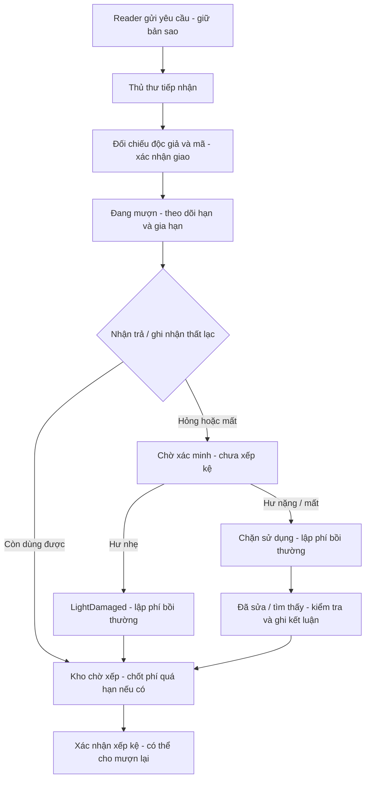

# Rà soát luồng Reader / Librarian — 12/11/2026

## Kết luận và cách đọc luồng

Luồng chính đã có kiểm thử xuyên các bước, nhưng chưa thể coi toàn bộ Librarian hoặc mọi tình huống ngoài đời đã hoàn tất. Phải theo dõi riêng ba đối tượng:

| Đối tượng | Trả lời câu hỏi gì? | Ví dụ |
|---|---|---|
| Phiếu mượn | Ai đang giữ cuốn sách, đã giao/trả chưa? | Pending → Approved → Borrowed → Returned |
| Bản sao | Cuốn vật lý đang ở đâu, còn dùng được không? | Kho, trên kệ, độc giả giữ; Good, LightDamaged, Damaged, Lost |
| Sự cố / phí | Hư hỏng đã xác minh chưa, ai phải đóng bao nhiêu, đã đóng chưa? | PendingReview → CompensationPending → Resolved; Fine Pending → Paid |

Một cuốn hư nhẹ có thể trên kệ dù phí của người mượn cũ còn Pending. Một hồ sơ đã Resolved vì đóng phí không có nghĩa cuốn hư nặng đã sửa xong. Lost là chưa tìm thấy, không phải có sách vật lý nằm trong kho.

Phí độc giả được thanh toán riêng; không dùng thao tác thu tiền để đổi tình trạng sách. QR chỉ nhận diện bản sao, không tự giao/trả/xếp kệ.

## Các sửa đổi từ đợt rà soát này

1. Theo lựa chọn của Long, khi chưa trả sách chỉ hiển thị phí quá hạn tạm tính. Bỏ thao tác lập phí sớm trên web, thay bằng đi tới nhận trả đúng mã. Backend từ chối chốt phí trên phiếu chưa Returned, kể cả gọi endpoint cũ trực tiếp.
2. Lập bổ sung phí cho phiếu đã trả dùng ngày trả thực tế, không dùng ngày hôm nay. Khoá phiếu trong transaction để hai lần ghi nhận đồng thời không tạo hai khoản phí.
3. Thông báo trả quá hạn phân biệt rõ phí mới, khoản phí đã có và chính sách chưa cấu hình. Không còn câu gộp hai nguyên nhân trái nhau.
4. Hồ sơ sự cố có phí quá hạn cũ không hiển thị khoản đó như một phí mới sẽ lập. Khi xác minh, liên kết khoản cũ để thanh toán bồi thường xong vẫn còn theo dõi đúng phí quá hạn chưa đóng.
5. Reader gửi báo mất/hỏng đồng thời được khoá theo phiếu: chỉ có một hồ sơ mở, không để gửi trùng làm kẹt xử lý. Báo cáo không tự kết thúc phiếu hoặc tự lập phí.
6. Màn xác minh hỏng trên web/mobile không tự chọn sẵn hư nhẹ; thủ thư phải chọn mức độ sau kiểm tra. Mất sách có loại Lost cố định.

Không xoá hoặc tính lại các khoản phí cũ người dùng đã tạo trong local; chỉ đối chiếu/thu phí giả lập qua luồng có sẵn. Không sửa dữ liệu Supabase, không commit/push.

## Bằng chứng kiểm thử

### Thao tác thật trên Simulator / DB local

- DEMO013-01: đúng mã vẫn bị chặn giao vì Long còn phí chưa thanh toán.
- DEMO011-01: nhận trả Good khi quá hạn 3 ngày; giữ đúng một khoản 15.000đ đã lập từ trước; bản sao về kho. Xác nhận riêng thu tiền mặt giả lập.
- DEMO002-01 và DEMO003-01: xem đúng ghi chú/hồ sơ của từng phiếu; thu phí hư nhẹ giả lập; trạng thái phí chuyển Paid và hồ sơ chuyển Resolved, giữ dấu LightDamaged.
- Quay lại DEMO013-01 sau khi đóng phí: giao thành công; ghi ngày mượn và hạn trả theo chính sách. Sau đó nhận trả Damaged với ghi chú `[QA local] Bong gay va roi trang 15-18; can xac minh hu nang.`; mở đúng hồ sơ PendingReview mới và chưa lập bồi thường.
- SQL kiểm tra tồn sẵn sàng theo từng bản sao khớp `books.available_copies` tại lúc kiểm tra. Đây không phải chứng minh mọi cạnh tranh đồng thời đều an toàn.
- Web Reader tài khoản Long: lịch sử đã thấy DEMO013 Returned cùng ngày mượn/trả mới, không còn phiếu quá hạn đang mở và phí chưa thanh toán là 0đ sau các lần thu tiền mặt giả lập.
- Đã kiểm tra UI mới: cả hư nhẹ/hư nặng đều chưa được chọn sẵn, phí hiển thị “Chưa xác định” và nút xác nhận bị khoá.
- Công cụ thao tác Simulator gặp lỗi `noWindowsAvailable` khi cuộn bằng toạ độ; vì vậy chưa hoàn tất xác minh mức độ/khôi phục qua UI cho DEMO013 trong lượt này. Các nhánh nghiệp vụ tương ứng có kiểm thử PostgreSQL riêng bên dưới; không coi lỗi công cụ là lỗi cuộn của app.

### Kiểm thử tự động

- API build: 0 lỗi, 0 cảnh báo. Unit test: **249/249**.
- PostgreSQL: **25/25**, schema riêng trong `smartlibrary_test_codes`, không đụng phiếu demo/Supabase. Bao gồm 14 ca trước và 11 ca mới trong `CirculationAuditTests.cs`:
  - Chặn chốt phí khi chưa trả.
  - Chốt phí đúng ngày trả trong quá khứ; hai thao tác lập phí đồng thời chỉ có một thành công.
  - Reader yêu cầu → giữ bản sao → duyệt → sai mã bị chặn → giao → trả hỏng → xác minh nhẹ → xếp kệ khi chưa thanh toán → thanh toán → mượn lại → trả hư nhẹ cũ không phạt lại. Trả bằng ID phiếu cũ bị chặn.
  - Mất sách: đóng phí vẫn không xếp kệ, chỉ phục hồi sau khi tìm thấy/kiểm tra có ghi chú.
  - Xác nhận thu tiền mặt lặp/đồng thời chỉ có một biên nhận.
  - Phí quá hạn cũ không tính trùng; liên kết đúng vào sự cố và chỉ đóng hồ sơ khi đủ các khoản liên quan.
  - Huỷ phiếu và quá giờ nhận giải phóng sách về kho, không tự lên kệ hay phát sinh phí mượn.
  - Reader báo hỏng không kết thúc phiếu; cần xử lý hồ sơ trước khi nhận trả Good.
  - Gia hạn: kiểm quyền sở hữu, người khác đang đặt trước, chặn quá hạn theo cấu hình, số lần tối đa.
  - Hai báo cáo mất/hỏng đồng thời chỉ mở một hồ sơ.
  - Nhận trả một cuốn đã được Reader báo hỏng đồng thời với xác minh: không deadlock, không lập phí trùng; dùng cùng thứ tự khoá phiếu → hồ sơ.
- Các ca trước vẫn kiểm tra hư nhẹ/nặng, phục hồi, trả đồng thời, xác minh/từ chối đồng thời, kệ đầy, hàng chờ đặt trước, không tăng tồn khi chuyển kệ, migration enum, mã sách và đọc hồ sơ đăng nhập.
- Mobile typecheck, web lint/build và `git diff --check` qua. Web còn cảnh báo bundle lớn có sẵn.

## Những gì chưa thể kết luận / việc tiếp theo

- Chưa kiểm tra camera trên điện thoại thật. Simulator dùng nhập mã; QR quét thiết bị thật và quyền camera cần một buổi kiểm tra riêng.
- Chưa kiểm thử end-to-end PayOS/webhook bằng tiền thật hoặc tình huống thanh toán sát lúc mất mạng. Local đã tắt PayOS; thu tiền mặt ở đây là giả lập.
- Chưa kiểm tra tải nhiều thủ thư cùng thao tác, Android, offline/reconnect ở mọi thời điểm. Các ca đồng thời ở trên chỉ chứng minh đúng những trường hợp cụ thể đã có test.
- Danh sách sự cố mobile mới lấy 50 hồ sơ gần nhất; lịch sử bản sao lấy 20 mục mỗi loại. Cần phân trang/tìm phía server trước khi dữ liệu lớn.
- Mobile làm mới khi quay lại app hoặc kéo tải lại; chưa có đồng bộ realtime đầy đủ cho mọi màn thủ thư.
- Theo cấu hình local được sao chép, hư nhẹ 20.000đ nhưng hư nặng/mất 15.000đ. Luồng tính đúng cấu hình, nhưng mức này chưa hợp lý để demo thực tế; cần chốt lại chính sách, không tự sửa ngầm.
- Nếu chính sách cho gia hạn sau quá hạn thì việc đổi hạn ảnh hưởng số ngày quá hạn; cần quy ước rõ trước khi dùng thực tế. Ca kiểm thử đang chứng minh nhánh chặn quá hạn khi chính sách bật, không tự thay chính sách hiện tại.
- Phạm vi mobile vẫn chưa gồm toàn bộ đặt chỗ, duyệt độc giả, hỗ trợ/chat thủ thư hoặc quản lý danh mục; tin tức/báo cáo/AI/Admin vẫn ngoài phạm vi đã thống nhất.

## Lộ trình test ngắn cho Long

Chỉ đi một cuốn mỗi lần, không mở nhiều ca cùng lúc:

1. DEMO009-01: Reader gửi yêu cầu mới, sang mobile thủ thư duyệt/giao, trả Good, xếp kệ; Reader kiểm tra lịch sử và số sẵn sàng.
2. DEMO013-01: đang ở hồ sơ chờ xác minh sau lượt QA này. Chọn hư nặng → ghi kết luận → xác nhận phí → thử xếp kệ (phải bị chặn) → đóng phí (vẫn bị chặn) → kiểm tra phục hồi sau sửa → mới xếp kệ.
3. DEMO005-01: hư nhẹ đã xác minh, đang trên kệ; thử mượn/trả giữ hư nhẹ cũ, không tạo bồi thường mới nếu không có hư hỏng mới.
4. Chỉ sau đó tạo ca quá hạn khác. DEMO011 đã được nhận trả và đóng phí trong lượt QA này; không còn là phiếu đang quá hạn.

Các tên sách `[Demo] ...` mô tả mục đích fixture ban đầu, không phải trạng thái hiện tại. Luôn đọc trạng thái trên phiếu/bản sao thay vì suy ra từ tên sách.
